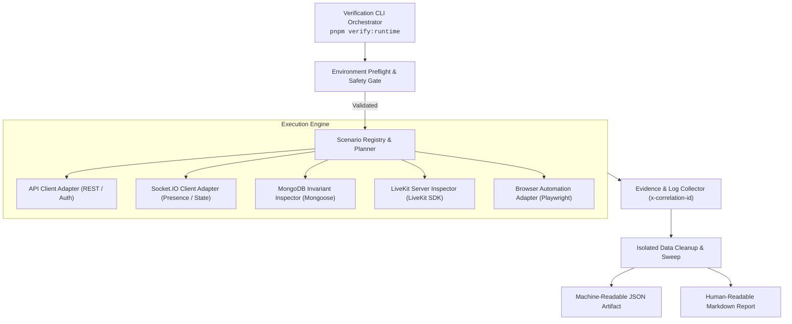

# Runtime Verification — Future Verification Runner Architecture

## 1. High-Level Vision & Objectives

The primary objective of the **Runtime Verification Runner** is to execute deterministic verification scenarios across all layers of the KTVOnline stack, collect cryptographically traced evidence, validate database and distributed invariants, and compile an automated **Release Readiness Report**.



---

## 2. Core Runner Components

### 2.1. CLI Orchestrator
- **Role**: Parses command-line flags, selects scenario subsets, initializes telemetry, and controls concurrency.
- **Fail-Safe Gate**: Inspects `process.env.NODE_ENV`. If targeting a production host without an explicit `--force-production-destructive-confirmed` flag, the runner **aborts immediately** with code `1`.

### 2.2. Environment Preflight Inspector
- Verifies connectivity to:
  - Backend API (`/api/v1/health/live` and `/api/v1/health/ready`).
  - MongoDB database connection and replica set transaction support.
  - LiveKit server signaling endpoint (`LIVEKIT_URL`) and credential validation.
  - Frontend web server (HTTP 200).
- If any preflight requirement fails, scenarios are marked `BLOCKED` rather than `FAIL`.

### 2.3. Isolated Test Account & Room Provisioner
- Dynamically provisions test identities:
  - Users: `rv_test_user_<role>_<runId>@test.ktvonline.internal`.
  - Rooms: `rv_test_room_<workstream>_<runId>`.
- Generates valid JWT pairs via standard authentication endpoints.
- Tracks all created IDs in an in-memory session ledger to guarantee cleanup even upon unhandled interruptions.

### 2.4. Protocol Adapters
1. **API Client Adapter**: Wraps HTTP requests with auto-injected correlation IDs (`x-correlation-id: rv-<runId>-<seq>`), latency timers, and automatic cookie storage.
2. **Socket.IO Client Adapter**: Multi-client socket connection manager capable of spinning up 1 to 50 concurrent virtual clients with event logging, monotonic sequence checking, and ack tracking.
3. **MongoDB Invariant Inspector**: Direct Mongoose connection for out-of-band state assertion (e.g. verifying that `RoomModel.currentParticipantsCount` matches `RoomMembershipModel.countDocuments({ status: 'active' })`).
4. **LiveKit Server Inspector**: Interacts directly with `RoomServiceClient` to query provider-side participant lists, published tracks, and mute states to verify server-side state synchronization.
5. **Browser Automation Adapter (Playwright)**: Launches headless Chromium/Firefox/WebKit instances with fake media streams (`--use-fake-device-for-media-stream`, `--use-fake-ui-for-media-stream`) to verify DOM updates, CSS transitions, and Web Audio behavior.

### 2.5. Evidence & Telemetry Collector
- Captures:
  - Request/response headers and bodies (with secret masking).
  - Socket.IO emitted and received packets with microsecond timestamps.
  - Server-side Pino logs correlated via `x-correlation-id`.
  - Browser console logs, network har files, and Playwright traces on test failure.

---

## 3. Proposed Command Interface (Planned)

The following commands represent the proposed interface for the unified verification runner once implemented:

```bash
# Run complete runtime verification suite (L1 + L2)
pnpm verify:runtime

# Run targeted workstream suites
pnpm verify:runtime:infrastructure    # RV-01
pnpm verify:runtime:rooms             # RV-02 (Room Management)
pnpm verify:runtime:realtime          # RV-02 (Socket.IO Events & Presence)
pnpm verify:runtime:voice             # RV-03 (LiveKit Voice Signaling & Webhooks)
pnpm verify:runtime:playback          # RV-04 (Karaoke Queue & Clock Sync)
pnpm verify:runtime:audio-ux          # RV-05 (Lyrics & Equalizer)
pnpm verify:runtime:recovery          # RV-06 (Fault Injection & Recovery)
pnpm verify:runtime:endurance         # RV-07 (Endurance & Soak Testing)

# Run with custom parameters
pnpm verify:runtime --workstream=RV-04 --level=L1 --verbose
pnpm verify:runtime --bail --report=markdown
```

> [!NOTE]
> These commands are **proposed architectural interfaces**. They do not exist in the root `package.json` at this stage.

---

## 4. Execution Feasibility Matrix: Automated vs Manual

| Verification Scope | Verification Target | Level | Feasibility Rationale |
| :--- | :--- | :--- | :--- |
| **REST & Auth Security** | Login, registration, token refresh, replay attack detection, route guards | **L1** | 100% Automatable via HTTP client + assertion library. |
| **Membership & Occupancy Invariants** | Concurrent room joins, capacity ceiling, member count atomic CAS | **L1** | Fully automatable via concurrent HTTP/Socket promises + Mongo inspection. |
| **Socket.IO Event Ordering** | Monotonic `stateVersion`, room presence snapshots, broadcast fanout | **L1** | Automatable via multi-socket test clients with sequence validators. |
| **LiveKit Signaling & Tokens** | Token generation, permission claims, room name hashing, expiration | **L1** | Automatable via API calls + LiveKit JWT decoder assertions. |
| **LiveKit Webhook Idempotency** | Webhook deduplication (`claimEvent`), monotonic sequence ordering | **L1** | Automatable via synthetic signed HTTP POSTs to `/api/v1/voice/webhook`. |
| **Karaoke Worker Leases & CAS** | Distributed lock acquisition, overdue track natural completion, recovery | **L1** | Automatable via direct DB manipulation and worker trigger hooks. |
| **Lyrics $O(1)$ Rendering** | Memoized row rendering, word sweep animation, reduced motion | **L2** | Automatable via Playwright (DOM snapshot comparisons and requestAnimationFrame inspection). |
| **Backing Equalizer Node Graph** | Web Audio filter creation, preset gain setting, CORS fallback | **L2** | Automatable via Playwright evaluating `AudioContext` destination node graph. |
| **Audio Device Selection UI** | Device enumeration, permission prompt handling, error banners | **L2** | Automatable via Playwright fake media devices. |
| **Acoustic Echo Cancellation (AEC)** | Speaker bleed suppression into microphone during high karaoke volume | **L3** | **Manual-Assisted Hardware**: Requires physical loudspeakers and microphones in acoustic proximity. |
| **Voice Intelligibility & Quality** | Perceived distortion, clipping under dynamic vocal delivery | **L3** | **Manual-Assisted Hardware**: Subjective human acoustic evaluation. |
| **EQ Acoustic Fidelity** | Sound warmth, bass distortion, high-frequency harshness | **L3** | **Manual-Assisted Hardware**: Subjective listening tests across studio headphones and monitors. |
| **Perceived Lip-Sync & Drift** | Perceived alignment between singer vocal utterance and backing track | **L3** | **Manual-Assisted Hardware**: Physical multi-user singing session. |

---

## 5. Ten Inviolable Safety & Verification Invariants

1. **Production Fencing**: Refuse execution against production hosts without explicit environment confirmation.
2. **Deterministic Preflight**: Validate host, database, and third-party dependencies before executing scenarios.
3. **Data Isolation**: Create all artifacts with isolated prefixes (`rv_test_*`) in dedicated test databases/namespaces.
4. **Guaranteed Teardown**: Clean up test users, rooms, and state in a `finally` block even when tests crash.
5. **Bounded Execution**: Every scenario must have a strict timeout (e.g. 15s for L1, 60s for L2).
6. **Strict Result Taxonomy**: Distinguish between `PASS`, `FAIL`, `BLOCKED` (environment/dependency missing), and `NOT RUN`.
7. **No Assumed Pass**: Never infer `PASS` from the absence of error logs; require explicit assertion proof.
8. **Evidence Preservation**: Automatically dump DB snapshots, socket transcripts, and server logs on failure.
9. **Secret Masking**: Automatically scrub JWTs, passwords, and API secrets from output artifacts.
10. **Machine & Human Reporting**: Output both a structured JSON test matrix (`results.json`) and a formatted Markdown report (`REPORT.md`).

